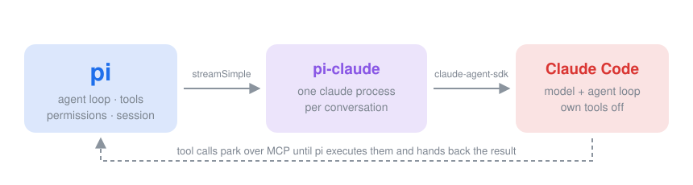

# pi-claude

<p align="center"></p>

Run [Claude Code](https://code.claude.com) as a model provider inside [pi](https://github.com/badlogic/pi-mono) and [omp](https://github.com/can1357/oh-my-pi).

You pick `claude-code/sonnet`. Claude Code becomes the engine; pi stays the agent. Every tool call Claude Code makes is executed by pi — through pi's own tools, permissions, and session log — and the result flows back. Claude Code never touches your files itself.

## Install

**pi**

```bash
pi install git:github.com/kubet/pi-claude
```

**omp**

```bash
omp plugin install git+ssh://git@github.com/kubet/pi-claude.git
```

From a local checkout: `pi -e ./pi-claude/src/index.ts`.

Needs a working `claude` CLI on your `PATH`, authenticated the way you already use it — subscription or API key. No keys to configure; the provider reports configured whenever the binary exists.

## Use

```
pi --model claude-code/sonnet          # or /model claude-code/opus in the TUI
```

Models are aliases your local Claude Code resolves: `default`, `sonnet`, `opus`, `haiku`. pi thinking levels map to Claude Code effort: `--thinking high` → effort `high`, up through `xhigh` and `max`.

Turns ride your Claude Code plan, so pi records zero catalog cost; token usage is recorded per assistant message.

## What happens

1. **One Claude Code process per conversation**, spawned through the claude-agent-sdk and kept alive across pi turns. User messages stream in; assistant messages stream back as pi events.
2. **pi's tools ride an in-process MCP server.** Claude Code's own tools are disabled; it sees `mcp__pi__read`, `mcp__pi__bash`, … and calls them like any MCP tool.
3. **Tool calls park.** The MCP `tools/call` waits unanswered while the provider ends the turn with a pi tool-call event. pi executes the tool — session log, extensions, everything — and the next model call resolves the parked request from pi's tool result. Claude Code never notices the seam.
4. **Divergence respawns.** Compaction, forks, or a changed system prompt break replay; the bridge respawns Claude Code and replays the transcript as a restore message.
5. **Subagents isolate.** Bridge selection prefix-matches the hashed user-message history, so parallel sessions and subagents each drive their own process (up to 6, LRU).

Claude Code features that duplicate pi's are turned off (opencode parity): CLAUDE.md/memory loading, auto-compaction, skills, hooks, `dontAsk` permissions — pi already gates tools. `ANTHROPIC_BASE_URL`, `ANTHROPIC_API_KEY`, and `ANTHROPIC_AUTH_TOKEN` pass through when set. The system prompt sent to Claude Code is pi's behavioral core (preamble and rules) with the harness chrome dropped: forwarding pi's full `<docs>`/`<skills>` sections verbatim bloats SDK turns enough to tip a subscription with thin rolling headroom into the overage path.

## Configuration

| Env | Effect |
| --- | --- |
| `PI_CLAUDE_EXECUTABLE` | Path to the claude binary (default: first `claude` on `PATH`) |
| `PI_CLAUDE_SYSTEM_BUDGET` | Max chars of host prompt forwarded (default `1600`) |
| `PI_CLAUDE_DEBUG` | Log spawns and SDK messages to stderr |

## Development

```bash
bun install
bun run check              # tsc --noEmit
bun test test/unit         # conversion + bridge orchestration, no claude needed
PI_CLAUDE_E2E=1 bun test test/e2e   # real pi + real claude, scratch projects
```

The unit suite drives the bridge through a scripted query factory. The e2e suite spawns the real pi CLI with the extension and asserts on observable outcomes: answers, files written through pi tools, multi-tool turns, memory across the parked-tool boundary, and recorded usage.

Design credit: the parked-MCP bridge, isolation env, and hook pairing mirror the claude-agent provider in [opencode](https://github.com/anomalyco/opencode); bugs are mine.
